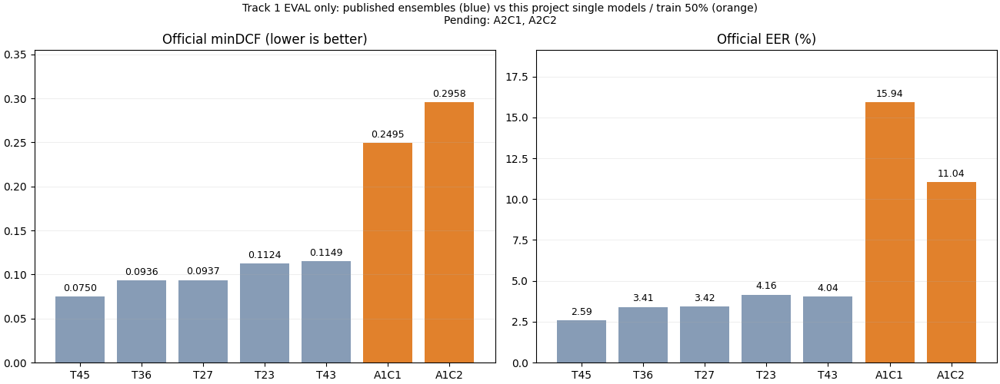

# ASVspoof 5 Track 1

ASVspoof 5 Track 1(stand-alone speech deepfake detection)용 코드. 동결한 SSL 백본(기본 `microsoft/wavlm-base`)의 hidden state를 learnable layer weight로 합치고, adapter(BiLSTM 또는 SE-Res2Net)로 줄인 표현 z 위에 분류기(LCNN-big 또는 SENet12, ASP pooling)를 둔다. 학습할 때는 z에서 clean 파형의 MFCC / CQT / LFCC / log-mel을 복원하는 보조 regression worker를 같이 붙여 BCE + λ·L1(λ=0.1)로 학습한다. 증강은 RawBoost, codec round-trip(mp3 / aac / amr-nb / narrowband-8k), RIR, SpecAugment를 쓴다. best checkpoint는 dev minDCF 기준으로 고르고, 평가는 EER / minDCF / actDCF / Cllr를 공식 방향(bona fide = positive)으로 계산한다.

원래 ADD 2023 Track 1.2용으로 만든 구조를 ASVspoof 5로 옮긴 것이다.

처음에는 WavLM-Large와 MUSAN을 썼는데, evaluation plan 4.2를 다시 보니 open condition에서는 Libri-Light / MLS로 사전학습된 모델과 MUSAN speech가 금지돼 있었다. WavLM-Large는 Libri-Light 60k 시간으로 사전학습돼서 LibriSpeech 960h만 쓴 WavLM-Base로 바꾸고 MUSAN은 뺐다. `utils/compliance.py`가 config를 읽을 때 이 조건을 검사한다.

## 구조

```
configs/baseline.yaml        기본 설정
data/
  protocols.py               ASVspoof 5 protocol 파서
  dataset.py                 waveform dataset / dataloader
  augment.py                 RawBoost, codec, MUSAN, RIR, SpecAugment
  cached_dataset.py          캐시된 SSL feature용 dataset
models/
  ssl_backbone.py            frozen SSL + layer weighted sum
  adapter.py                 BiLSTM / SE-Res2Net adapter
  classifier.py              LCNN-big / SENet12 + ASP
  workers.py                 보조 regression worker와 target 계산
  model.py                   전체 모델
utils/
  metrics.py                 EER, minDCF, actDCF, Cllr
  compliance.py              open condition 규정 검사 (금지 SSL 모델, MUSAN)
  tracking.py                W&B 로깅 (실패 시 로컬 jsonl)
  run_meta.py                git commit, 환경 정보 기록
scripts/
  download_asvspoof5.py      HF에서 데이터 다운로드
  cache_ssl_features.py      SSL feature 캐시
  collect_runs.py            run별 결과 표 / csv
  wandb_replay.py            로컬 로그로 W&B run 복원
  run_wavlm_base.py          WavLM-Base 2x2 실험 전체 실행 (데이터 준비, 학습, dev/eval 점수)
  official_track1_report.py  주최측 evaluation-package로 eval 채점, 공개 시스템과 비교
  experiment_dashboard.py    학습 곡선, ROC/DET, 점수 coverage 검사
train.py                     학습
train_cached.py              캐시된 feature로 adapter + classifier만 학습
evaluate.py                  dev / eval 평가
notebooks/
  ASVspoof5_wavlm_base.ipynb     Colab, WavLM-Base 2x2 학습과 공식 채점
  ASVspoof5_colab.ipynb          Colab, full train (WavLM-Large 때 버전)
  ASVspoof5_colab_subset.ipynb   Colab, 50% 층화 subset + 증강 + eval 분석
  data_analysis.ipynb            샘플레이트 / 길이 / 패딩 분포 확인
tests/                         공식 채점 스크립트, 그림 생성 테스트
results/wavlm_base/            공식 eval 결과 json과 그림
```

## 데이터

HF `jungjee/asvspoof5`에서 받는다.

```
pip install -r requirements.txt
python scripts/download_asvspoof5.py --local-dir raw [--include-eval]
```

tar를 `data.root`(기본 `./data/asvspoof5`)에 풀면 `flac_T/`, `flac_D/`, `flac_E_eval/`, `protocols/*.tsv`가 생긴다. 경로가 다르면 `configs/baseline.yaml`의 `data` 항목을 고친다.

## 실행

학습

```
python train.py --config configs/baseline.yaml --tag a1c1 \
    --adapter bilstm --classifier lcnn_big \
    --dev-subset 5000 --dev-batch-size 64 [--epochs N] [--batch_size B]
```

- `--smoke N`: train N개로 빠르게 확인
- `--resume ckpt/baseline/a1c1/last.pt`: 이어서 학습 (`--save-every N`으로 epoch 중간 저장)
- `--save-all-epochs`: epoch별 `epoch_NN.pt` 저장
- `--wandb` / `--no-wandb`, `--wandb-project`, `--wandb-run-name`

결과는 `ckpt/baseline/<tag>/`에 `best.pt`, `last.pt`, `history.json`, `train_log.jsonl`, `run_meta.json`, `config_used.yaml`로 남는다.

캐시된 feature로 학습 (SSL forward 없이 adapter + classifier만, worker 없음)

```
python scripts/cache_ssl_features.py --config configs/baseline.yaml --split train --out cache/train
python scripts/cache_ssl_features.py --config configs/baseline.yaml --split dev   --out cache/dev
python train_cached.py --config configs/baseline.yaml --cache-dir cache --tag a1c1_cached
```

캐시는 layer weight 초기값(균등 평균) 기준이고 증강도 고정되므로 구조 탐색용으로만 썼다.

평가

```
python evaluate.py --config configs/baseline.yaml --ckpt ckpt/baseline/a1c1/best.pt \
    --split dev --metric official --out scores/dev_a1c1.tsv [--sliding] [--batch-size 64] [--limit N]
```

기본은 공식 baseline과 같은 방식(앞 4초 한 구간, 짧으면 반복)이고 `--sliding`은 4초 window / 2초 hop 평균이다. `--metric official`이면 score = −logit(클수록 bona fide). 출력은 `<file_id>\t<score>\t<label>` TSV와 `_summary.json`.

WavLM-Base 2x2 실험 (Colab)

```
python scripts/run_wavlm_base.py --project <repo 경로> --combos a1c1 a1c2 a2c1 a2c2
python scripts/official_track1_report.py --output <repo 경로>/experiments/wavlm_base_no_musan_20261106
```

`run_wavlm_base.py`는 train에서 `(key, attack_tag)` 층화로 50%를 뽑고(seed 42) smoke test 후 조합별로 학습한다. batch 48, 최대 20 epoch, patience 6이고 best.pt는 epoch마다 dev 5,000개 minDCF로 고른다. eval은 best.pt 하나로 680,774개 전체를 sliding 없이 점수화한다. `official_track1_report.py`는 주최측 repo(commit `fe23d30`)의 `evaluation.py`로 다시 채점하고, 점수 개수 / ID 중복 / 라벨이 프로토콜과 맞는지 먼저 확인한다.

여러 run 비교

```
python scripts/collect_runs.py --ckpt-root ckpt --out runs_summary.csv
```

Colab에서는 `notebooks/ASVspoof5_colab_subset.ipynb`를 위에서부터 실행하면 된다 (`DRIVE_ROOT`만 수정).

## 결과

Track 1 eval 전체(680,774개)를 주최측 evaluation-package로 채점한 값. train 50% subset으로 학습한 단일 모델이다.

| 조합 | adapter + classifier | minDCF | EER (%) | actDCF | Cllr |
|---|---|---|---|---|---|
| A1C1 | BiLSTM + LCNN-big | 0.2495 | 15.94 | 0.6338 | 1.0908 |
| A1C2 | BiLSTM + SENet12 | 0.2958 | 11.04 | 0.5009 | 0.8670 |
| A2C1 | SE-Res2Net + LCNN-big | - | - | - | - |
| A2C2 | SE-Res2Net + SENet12 | - | - | - | - |

A2C1, A2C2는 아직 끝나지 않았다. A1C1의 전체 dev(140,950개)는 EER 12.40%, minDCF 0.1891.



같은 eval에서 공개된 open condition 상위 시스템(T45 0.0750, T36 0.0936, T27 0.0937, ASVspoof 5 논문 Table 4)과는 차이가 크다. 상위 시스템은 2~6개 모델 앙상블이고 train 전체를 썼기 때문에 같은 조건의 비교는 아니고, 제출 순위도 아니다. 백본이 같은 T36, T27과 비교해도 minDCF가 0.15 넘게 높다.

- actDCF가 minDCF보다 훨씬 높다 (A1C1 0.63 vs 0.25). 점수가 calibration 안 된 raw logit이라 Bayes threshold가 맞지 않는다.
- 공격별로는 A28이 가장 어렵고 (A1C2 minDCF 0.81, EER 32.7%) 다음이 A31.
- codec별로는 C07, C08, C10에서 많이 떨어진다.

공격별 / codec별 그림, ROC / DET, 점수 분포는 `results/wavlm_base/`에 있다.

이전 README에 적었던 WavLM-Large 결과(a1c1_v2_subset50, EER 4.18%, minDCF 0.1143)는 open condition에 맞지 않는 백본이라 표에서 뺐다.

## 참고

- ASVspoof 5 Evaluation Plan (Delgado et al., 2024), ASVspoof 5 (Wang et al., Interspeech 2024)
- WavLM (Chen et al., 2022), RawBoost (Tak et al., 2022), PASE+ (Ravanelli et al., 2020)
- LCNN (Wu et al., 2018), SENet (Hu et al., 2018), Res2Net (Gao et al., 2019), ASP (Okabe et al., 2018)
